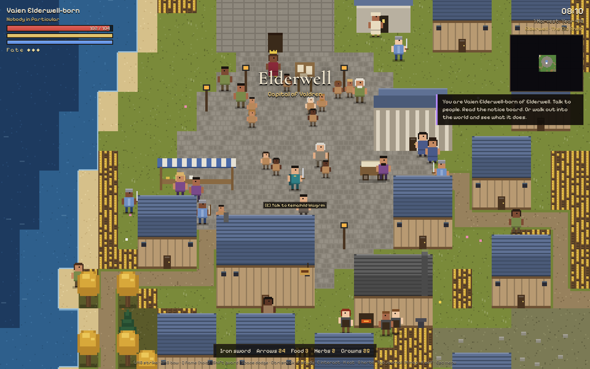
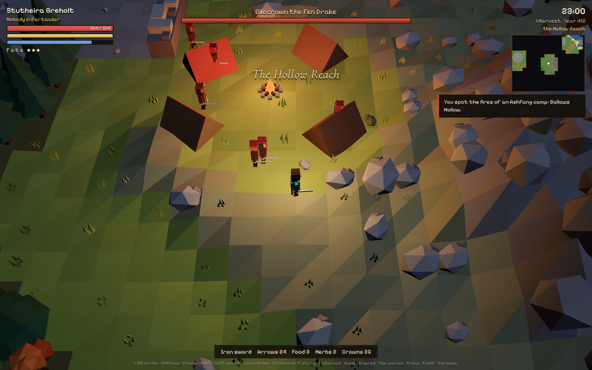
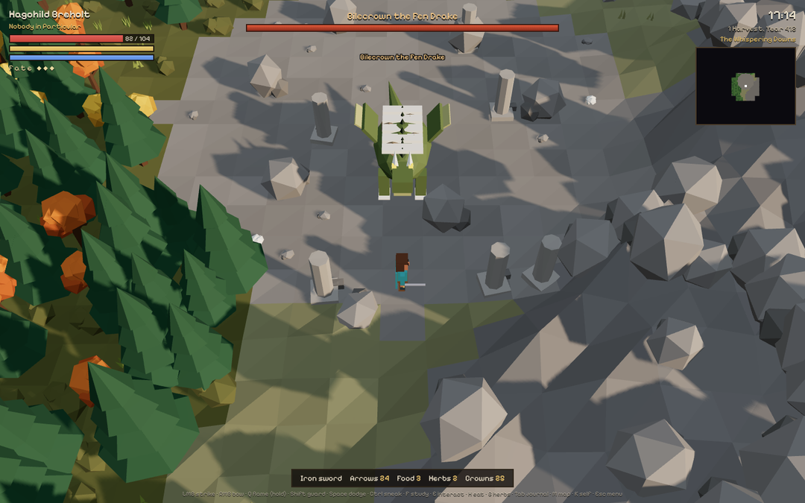
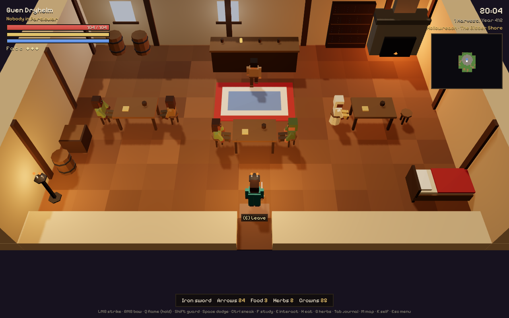
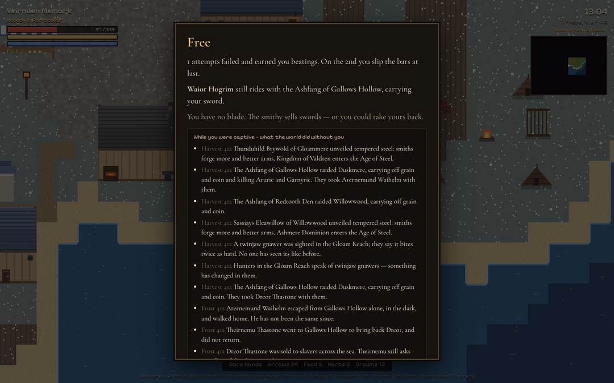
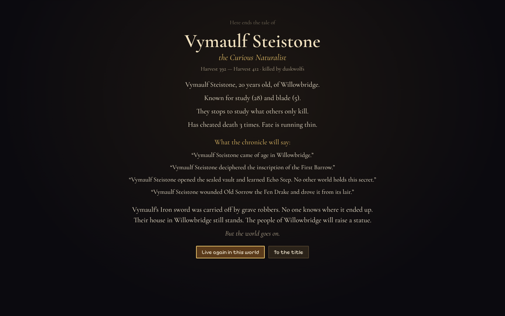
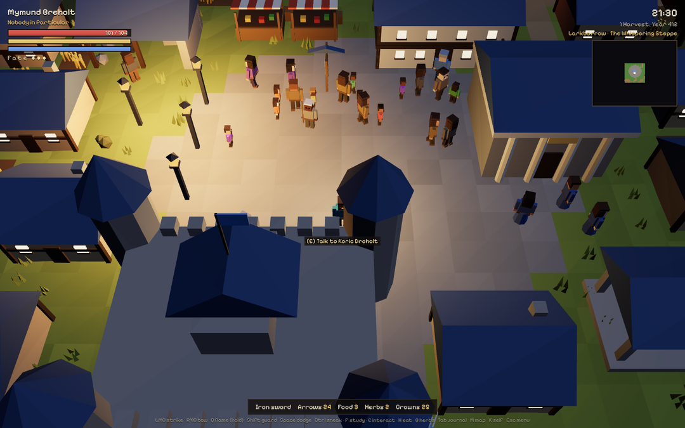
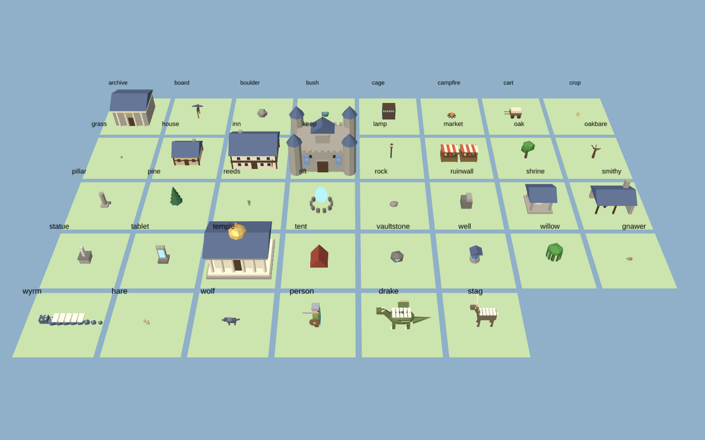

# ECHO — The Living Realm

> *A world that existed before you, continues without you, remembers what you do, and may never become the same world twice.*

ECHO is a desktop RPG built around one idea: **consequence**. You begin as an ordinary person in a world that is already alive — kingdoms, a religious order, outlaws, monsters, an economy and an ecosystem — and none of it waits for you.



**Now in 3D.** Every building, tree, person, beast and boss is a model built in Blender (`blender/build_assets.py`) with bevelled edges, rounded forms and smooth shading that keeps its real creases, drawn with Three.js under a moving sun with real shadows, fog, lanterns and campfires that light the dark, windows that glow at night, crops that thin when vermin eat the fields, and snow in winter. ECHO is 3D only: it needs WebGL (any computer from the last decade has it). If a browser or machine can't provide it, the game says so instead of starting, and your worlds stay safe. People you talk to are shown in a portrait drawn from their own 3D model, in their own clothes and gear.

**How it looks.** The picture is finished the way big engines finish theirs, inside ECHO's own renderer: the scene is drawn in high precision with multisampled edges; bright things bloom (flames, lanterns, windows at night, spells, the gates, a titan's breath); ambient occlusion darkens the creases and the places where things meet the ground; a filmic tone curve and a colour grade follow the hour and the weather (warm at dawn and dusk, cool and quiet at night, greyer in a storm, close and amber indoors); the sky lights the world as well as the sun, so metal picks up the colour of the day; and every surface has its own grain and patches instead of one flat colour. **It stays smooth, even at full gallop or on a dragon's back:** only the land the camera can see is drawn (and into the shadows), with plain far versions of the trees, crops and stones beyond the ground around you; the land ahead is built before you reach it, a few milliseconds a frame, and what is behind is kept a while in case you turn round; towns, hidden places and newcomers are put together over a few frames instead of all at once; every kind of shader is built in the background once the world is up, so nothing new on screen makes the game stop to build one; the sun's shadows step with the shadow map's own grid (no crawling edges) and refresh every frame once you move fast; and if frames start taking too long the game lowers its rendering resolution (and, if that isn't enough, drops ambient occlusion and then bloom), judging by the typical frame rather than a few slow ones, and changes it seldom. **It reads clearly:** the ground is drawn with crisp patterns of its own — cobbles and mortar in the squares, pebbles in the roads, furrows in the fields, ripples in the sand, cracked plates of bare rock, flagstones in the ruins, tufts in the grass — roofs have rows of shingles, and a fine line traces where one thing stands in front of another. **It stays sharp:** the 3D picture is drawn at your screen's own sharpness (up to 1.5 pixels per screen pixel on Medium and 2 on High, so a laptop at 150% or a 4K monitor isn't stretched and soft), with a gentle sharpening pass; the labels over the world always are; and when the game has to lighten its load it drops effects before it lowers the resolution. Quality (Esc menu): Low draws plainly and fastest, Medium adds shadows, bloom, smooth edges and grading, High adds ambient occlusion and finer detail.



## What's in this build

Every system below is real and connected to the others. Nothing is scripted.

**Tame anything**: beat any beast, monster or lord down and tame it (E) — lords fall beaten instead of dying, for you to tame or finish. Up to three follow you and fight at your side, grow on their kills and rest a day when beaten; twelve can be kept.

**Potions of many kinds**: healing comes in three strengths — minor (cheap), the healing draught and the greater draught that closes every wound — and **1** drinks the one that best fits your wounds. Beside them: the mending tonic that heals slowly but deeply, the purging tincture against poison, fire, fever and snares, the second-wind cordial that refills your stamina and doubles its return, the heartroot elixir for fifty more life, bloodwine that heals you with every blow you land, and phoenix tears that, carried, save you once from a killing blow. Each has its own makings and price; the apothecary makes them from your herbs and monster parts, or sells them ready-made for crowns alone (all but the phoenix tears).

**Magical equipment and growing mana**: relics — rods, rings, amulets, boots, pendants, orbs, torcs — worn three at a time and woken with Z, X and C, each spending mana: chain lightning, frost nova, an arcane barrier, blink, a healing bloom, spectral blades, a binding that keeps a beast from dying and eases its taming, and a falling star. They drop from what you kill (more often from the strong) and the arcanist in every market sells three, changing every three days. Weapons may be Arcane (each blow draws mana and strikes 40% harder) and armour Manaweave (a third of the harm that reaches you is paid in mana). Your mana capacity grows with use — every point spent and every moment in battle deepen the well. **Taming without killing**: the leash (L) makes anything tameable that you or yours strike down fall beaten and kneel instead of dying; nothing kneeling can be hurt by your blows, only finished on purpose (E).

**A full, finer map**: the whole world is revealed on the map from the start — every town, dungeon, camp, lair, landmark, hidden place, deep wood and gate (switch to only what you have walked if you prefer to explore) — painted in fine detail with shaded relief, inked coasts, dotted woods, drawn roads and trails, with a search for any place by name.

**Forests you can walk, and woods you should not**: every forest has trails worn through it to its heart (faster than anywhere off a road), and the greatest forests hold deep woods — dead and twisted trees, eyes in the dark, whispers and a hunting horn — where six new beasts with arts of their own (the Gloamstalker, the Hollow Man, the Barkhulk, the Weeping Bride, the Bough Widow, the Briarwyrm) grow deadlier the deeper you go, and a lord of the Wild Hunt waits at the heart. Caches of the lost lie along the trails.

**The National Guard works the whole realm**: its blue-caped auxiliaries (the realm's best soldiers, training harder than anyone) ride patrol on the roads and garrison the towns in danger; when a beast gets out of a gate a warden comes down to run it down; named monsters that grow too strong are culled; and anyone can take the Guard's contracts, while sworn members get orders, merit, the armoury and a weekly wage. The Journal's *The Guard* page shows it all.

**Your money matters**: every notice board's *Spend your coin* page lets you train with the town's master-at-arms (a third of a level a day), arm and drill the town guard, pay for walls, a watchtower or a granary, throw a feast, or put a price on a named monster's head so the realm's fighters hunt it down (kill it yourself and you take the coin back). Shrines sell three-day blessings (valour, warding, swiftness, fortune) and smiths take commissions for epic and legendary masterworks at your level.

**Everything that fights grows**: monsters, wolves, outlaws and townsfolk level up in the middle of a fight, learn to meet the way you hurt them, and each kind remembers how you fight it. A monster that beats you, kills someone or grows twice in a fight takes a name and lives on: it grows day by day, learns arts, gathers a warband, claims land, raids towns, fights the other named ones and comes looking for you. The realm's fighters train toward a level of their own (soldiers and guards half to three-quarters of yours, the rival adventurers yours), become their towns' champions and hunt the named monsters themselves; what roams the open land meets you at half to nine-tenths of your level. Levels for you, the people and the monsters all run to 1500. (Journal → Rising powers.)

**Bodies are solid**: your beast has a body as big as it looks and steps round trees, rocks and walls; a dragon flies over a wood rather than through it, keeps above the tree tops, and lands only where it fits. You slide round trunks and thread your way through thickets.

**The weather turns gradually**: clouds gather before rain, rain builds and eases, fog rolls in and lifts, and neighbouring regions' weather blends at their edges.

**Your beast is a partner.** A bound dragon or great beast has a mind of its own: it moves like an animal (arcs, pace, a look at whatever catches its eye), keeps you company at your pace, and when you stop it keeps watch, sniffs about, stretches, lies down to rest or circles the sky above you; it hunts when it is hungry and eats its kill; in a fight it goes for whatever is hurting you and uses all of its own arts as it sees fit (its greatest when you are in danger), takes to the air against a crowd, pulls back to recover when badly hurt; it greets you, lets you stroke its neck (E), and grows closer to you over time (its bond, on the Animals page).

**Flying** on a bound dragon (V) is a take-off and a landing, with weight in between: it banks into turns, trades height for speed, glides when you let go, holds the height you choose (Space higher, Ctrl lower) over the land, and leans you into the turns on its back. Your beast keeps a body's length off, away from the camera's side of you, so it never hides you in a fight.

**Combat you can feel**: every blow lands with a flash and sparks thrown the way it was struck; what you hit spills what it is made of (blood, bone chips, stone grit, slime, wisps of spirit) and it falls, bounces and stains the ground; fire leaves scorch and embers, frost shatters into shards and rimes the ground, lightning arcs from the wound, venom splashes; heavy blows and crits ring out with a shockwave; fireballs burst into a fire cloud and a smoke column; arrows and spells trail light; and the fallen leave a mark where they lay. Every blow that can be dodged is warned on the ground first by a glowing shape lying on the land: a charge sweeps across it as the blow winds up, it pulses faster as the moment comes, and it flashes as the blow lands.

**Dragons have skeletons**: one skin over 31 bones, so the neck curves, the spine bends into turns, the tail sways and trails, the legs bend at knee and ankle and the wings fold at elbow and wrist — and every wingbeat rolls from shoulder to fingertip.

**Dragons** are modelled as creatures, not blocks: one smooth body along the spine, a long neck and tail with a belly of their own colour, horned heads with jaws that open, clawed legs, spined backs and wings of skin between finger bones that fold on the ground and open in flight.

**A living world.** Every inhabitant is a persistent person with a name, family, traits, memories and opinions. They work, eat, feud, marry, have children, change trades, migrate when hungry, turn outlaw when desperate, rise through the ranks, and die — whether or not you're watching. Kingdoms collect taxes, pay soldiers, suffer riots, crown usurpers, declare war over hunger, and conquer each other's towns.

**People with purpose.** Everyone has a goal that grows out of who they are and what is happening to them — saving for a stall, courting a neighbour, becoming a master smith, making sergeant, a pilgrimage, the reeve's chair, fleeing the monster in the hills, or avenging a murdered parent. Goals advance every day and succeed or fail, changing lives. Each person also perceives their own world — how safe it is and from what, whether there is bread, what they think of their ruler, and what the rumours have told them about you — and acts on it: the frightened come home before dark and run for a door when wolves appear, the bereaved attack their parent's killer on sight, the grateful bring gifts, friends cover for your crimes, and shopkeepers charge what your name is worth. Ask anyone *What do you want most?* and help if you like; the journal's *People* page tracks everyone who has feelings about you.

**Music that is never the same twice.** The score is composed live: each place and moment — the wild by day and by night, towns, inns, temples, fights, bosses, festivals and the uncanny — has its own key, mode, tempo and instruments, and short pieces are written on the spot from a motif and its answer, then left to silence. Birds sing by day, crickets by night, wind rises in winter and on the hills, water murmurs by rivers, and discoveries are marked by stingers.

**Wonders.** Twelve Echoes of the old world lie far from any town; on clear nights wisps gather and lead the patient to them, and each shows a vision of the people who spoke the world's dead tongue — teaching words of it, adding life, and every fourth restoring a thread of fate. Stars streak across clear skies and some fall to earth, leaving star-iron that a smith can forge into your blade, a priest can give to the flame, or a merchant will pay well for. The restless dead linger by their homes at night with last words for someone; carry them home. A white hind walks the forest's edge at dawn and dusk — approach quietly for her blessing, or kill her and carry her curse. Fireflies fill warm nights.

**Festivals.** Four times a year — the Kindling Fair, Lantern Night, the Harvest Feast and Longnight — every town that can afford it gathers in the square: a bonfire, strings of lanterns, a ring dance, wishing lanterns rising into the dark, the feast (where the old ones tell where the echoes are), an archery contest, and Longnight's vigil until dawn. Starving or plague-struck towns go without, and remember it. Couples are betrothed at the dance.

**Reasons to come back.** People who know you write letters — weddings, children named after you, deaths, threats, pleas — which wait at the next town you enter. Each real day brings an omen: the hind seen in a certain wood, a night of falling stars, restless wisps, a star-merchant in some market. And the world lives on while you're away: a day for every two hours, up to five, with a digest of what happened when you return (this can be switched off in the pause menu).

**Townsfolk who know where they are.** People only walk to places they can actually stand: a goal inside a wall, a tree or a pond is moved to open ground, a blocked straight line becomes a planned route, routes through woods step around trunks, and a place with no way in makes them think again rather than walk into the wall. They step aside for people in their way, face whoever they came to talk to, and react to their own state and the sky — the sick keep to their beds (with a morning trip to the healers), the wounded go to be tended, storms empty the streets, rain sends idlers under a roof, bitter winters send people home early, and the hungry go looking for bread.

**Law and courts.** Each realm keeps its own law — the King's Peace hangs murderers, the Merchant Charter takes a blood-price, the Lantern Rule banishes — and each town bends it: harsh or merciful reeves, judges who can be bought, curfews, temple towns that forbid fire within their walls. Crimes are recorded with the names of the witnesses. Guards try to arrest you before they fight (come quietly, pay on the spot, or resist); at trial you plead, friends speak for you, and the sentence may be a fine, the stocks, the cells, banishment or the gallows. Townsfolk are tried too — thieves fined, feuding killers hanged.

**Weather and disease.** Every region has its own skies with memory: dry spells become droughts that wither the crops, wet seasons flood the river towns, bitter winters cost bread and take the old. Plagues are born in hungry, crowded or flooded towns, spread house to house and ride the roads with caravans, pilgrims and armies; healers and herbs blunt them, wise reeves shut the gates, and you can catch them too.

**Property, work and money.** Houses, fields and workplaces belong to someone. Owners pay wages and collect rent; the poor borrow and can lose their homes; when someone dies their house, savings, business and debts pass to their heirs — sometimes with a family quarrel. You can buy or rent a house, buy fields worked by tenants, buy shares in a mill, mine, smithy or inn, and lend money (and take defaulters before the reeve).

**Production chains.** Towns have mills, mines and lumber camps worked by named people. Grain becomes flour at the mill, the smith needs ore and charcoal, and the labour market moves people to the plough when bread is dear. Kill the miners and the ore stops; burn the mill and bread climbs until the reeve finds timber and coin to rebuild.

**Lives on the road.** Pilgrims, migrants fleeing hunger or fear, fortune-seekers, caravans and marching armies are real people you meet mid-journey; they tell you where they're going and why, and bring the news of the town they left. Ask anyone about the people in their life and they'll tell you what each of them is doing — or how they died.

**Pace of life.** Choose Brisk, Steady or Lifelike when you create a world (or later in the menu): a day lasts 6, 12 or 24 real minutes.

**Consequences that chain.** Each region has a food web. The great apex beasts keep the crop-eating vermin down. Kill one and, over the following weeks, the vermin multiply, the fields are stripped (you can see the crops thin), bread prices climb, people go hungry, migrate, riot, turn to banditry, and hungry kingdoms grow warlike. The game never tells you it was your fault.

**World intelligence.** Factions remember *how* they are being killed. Shoot the Ashfang and they start carrying shields; burn them and they ward against fire; strike at night and they post watches; kill their chiefs and chiefs keep bodyguards. Beasts evolve over generations under the same pressure (ashen wolves that won't burn, ironhide hides that turn blades), and rare mutations appear that may exist in no other world.

**Bosses that learn.** Apex monsters watch which way you dodge and strike where you're going. Turtle behind your guard and they break it. Snipe from cover and they smash the cover. Beaten, they flee — and come back armored against whatever hurt them most, and they remember you.



**Combat with weight.** Strikes chain into a three-hit combo that ends in a spinning finisher; hold the button for a heavy, guard-breaking blow that staggers whatever it hits. Every hit lands with a beat of hit-stop, sparks, a camera kick and synthesized sound; kills throw bodies back; a perfect guard rings like a bell and slows time for a moment. Foes flash before they strike so you can read them. A dodge-roll and buffered inputs keep it responsive, and loosing an arrow just as the bow reaches full draw makes a perfect shot.

**Techniques found in battle.** Fight a lot and your body discovers how it likes to fight. Fifteen techniques each wait behind a habit: enough perfect guards and you find the *riposte*; enough rolls under a blade and you *lunge* out of them; enough finishers and the spin becomes a *whirlwind*; enough fire and your blade catches it (*ember edge*); enough kills and you learn the *war cry*. Others come from blocking, staggering foes, unbroken combos, close calls, taking punishment, slipping hits, arrows, perfect shots, flame and stealth. Each grows through three ranks with use. You can carry two at first and up to five as you learn more, so the build is yours to choose on the character page.

**Places in the wild.** Every world scatters landmarks across its land — standing stones that teach the old tongue, lookouts that fill in the map and reveal what lies around them, moonwells that heal at night, a great oak to rest under, old battlefields to search, wayside shrines and wrecks — and *delves* to clear: barrows and crypts of the restless dead, wolf dens, and outlaw hideouts, each a room below ground with a master by its chest. Cleared delves fill again in time. Towns post quests to match: something stirring in a barrow, a child lost in the woods (find them and lead them home), a great named wolf to hunt, a treasure map, a parcel for someone in another town. The archives buy accounts of what you find.

**Rulers with aims.** Each ruler pursues an agenda shaped by their character and their realm's state — expansion, building, conquest, trade, faith or security — and re-chooses it as things change. Kingdoms commission walls, granaries, houses, roads, watchtowers and statues (and pay for supplies); issue decrees such as bounties, conscription, tax changes, alms, curfews and fire bans; sign trade pacts, arrange royal marriages and fight joint campaigns; and send surveyors to the frontier to found new villages. Clear the land before the settlers set out and you name the village and become its warden, with a share of its dues each season. Courts breed plots — expose them, join them, or blackmail the plotter — and a plot left alone may end in a coup. The Lantern brokers peace in long wars and defends its faithful.

**A purpose: six ambitions.** At the start of a life you choose what it is for: **the Blade** (Sellsword → Champion → Knight → Beastbane → Legend), **the Crown** (Householder → Warden → Steward → Lord → High Lord), **the Purse** (Peddler → Shareholder → Landlord → Merchant Prince → Banker of the Realm), **the Lore** (Seeker → Lorekeeper → Echo-walker → Vault-opener → Keeper of the Old Tongue), **the Road** (Wanderer → Pathfinder → Cartographer → Trailblazer → Worldwalker) or **the Watch** (Deputy → Constable → Sergeant → Captain → Lord Marshal). Every standing asks for concrete deeds in the world, is marked with a ceremony, changes the title people know you by, and brings a reward — more life, a carried technique, better prices, cheaper coaches, a stipend from the crown, a statue. You rise on every road you walk, not only the one you chose. A line at the top of the screen always shows the next step on your road, with an arrow, the distance and, when it is near, a beacon of light over the place; any quest in your journal can be tracked instead.

**A village of your own.** Buy a royal charter at a capital's keep (renown 20, 250 crowns). Clear the land the crown grants you, return to name your village, and the settlers follow. From then on you are its warden. Fund works (houses, fields, a granary, a palisade, a watchtower, a market fair, your own statue), set the dues (low to let it grow, high to grow rich and make it angry), and send criers to draw settlers. It grows, or starves, with the rest of the living world.

**Work and travel.** Take a three-hour shift at a mill, mine, lumber camp, smithy or inn for wages that follow the town's prosperity. It trains your skills and earns you goodwill. Coaches run along the roads between towns: pay the fare and the hours pass while the world goes on, though outlaws on dangerous roads sometimes stop the coach.

**Vast worlds.** New worlds are *vast* by default: 320×240 tiles (2.5 times the area) with about fifteen towns, 48 regions, highlands and peaks, more rivers, lairs, ruins and outlaw camps, a denser road network, and twice the landmarks, delves, wonders, caches and herbs. Neighbouring towns send grain to each other in hard times. Standard-size worlds and existing saves still work.

**Dungeons, monsters and loot.** Below the world lie dungeons spread across the whole map: catacombs, goblin warrens, spider nests, troll dens, drowned sanctums and deep forges, alongside the older barrows, crypts, dens and hideouts. Every dungeon and cave carries a level from 1 to 150. The old island's run from level 1 to the teens; out in the far lands past its shores they grow deadlier the further you travel, all the way to 150. Caves go at least three floors deep and dungeons further, up to twelve floors in the deadliest places, and every floor down is stronger than the one above (2 to 8 levels a floor). Each has several floors joined by stairs, a cache on every floor and a lord waiting on the last (see *Dungeons you explore* below): the Necromancer, the Goblin Warlord, the Spider Queen, the Ogre Chieftain, the Forge Golem. There are eighteen kinds of monster, each with its own strength and abilities: skeletons that shrug off arrows, ghouls with rotting claws, goblins that hunt in packs, shamans that throw fire and heal, giant rats, spiders that poison and spit webs, slimes that split when cut, trolls that regenerate unless burned, wraiths that teleport and drain your life, cultists casting purple fire, stonelings that bounce arrows, and bosses that summon, slam and charge. Monsters carry their floor's level: the higher it is, the more life and bite they have and the better the gear they drop, up to level 150 equipment. Some are elites (Hulking, Frenzied, Venomous, Ancient). Every kind you kill goes into your bestiary along with its weakness. Monsters drop coins, parts and gear: bone dust, spider silk, venom, troll hide, ectoplasm, golem cores, grave-iron, heartstones and more. The gear comes in five rarities, and the best pieces carry powers of their own (ember, venom, thirst, keen; warding, thorns, vigor). Sell parts and spare gear at any market. Or take them to a smith, who will hone your blade, restring your bow and reinforce your armour, five steps each, and make armour from hides, silk, troll hide, grave-iron and golem cores. What a smith makes is made for you: never weaker than its recipe, and as strong as gear of your level and its quality (the rarer the parts, the finer the piece). Each honing step adds a twentieth of the piece's power, so it is worth doing at any level.

**Seeing death coming.** A single blow never takes you from a healthy life bar straight to the ground. If a hit would kill you while you still have a quarter of your life, you're left standing on a sliver for a moment (once every 25 seconds), so you can get away, eat or use herbs. A pale piece of the life bar shows what each hit took before it drains away. Below a third of your life the bar beats and the edges of the screen go red. When you fall, the wake-up screen shows what brought you down: who hit you, with what, and how much of your life each took.

**Growing stronger, and knowing your enemy.** Every foe you defeat gives experience. The stronger it is than you, the more you get; things far beneath you teach you almost nothing. Experience raises your level and your rank: Novice, Fighter, Veteran, Champion, Hero, Legend, Mythic, then Wayfarer of the Far Lands, Warden of the Deep, Ascendant, Paragon, Demigod, Eternal, Worldbreaker and, at 150, the Undying. The world's dungeons and beasts take you no further than 150; past that only the gates, and the titans (who grow as you do), can teach you more. Beyond that only the gates can teach you anything, up to level 1500 (Gatewalker, Breachwarden, Voidtempered, Titan, Starforged, Godslayer, Worldwarden and, at 1500, the Eternal Sentinel). Each level adds 7% to every blow you strike, with sword, bow and fire, plus life and stamina; each new rank gets its own ceremony. Your level, rank and experience bar sit under your name, and your cape takes your rank's colour. Every foe shows its level and rank. Wolves, outlaws and great beasts are measured too, not only dungeon monsters. The label is coloured by how the foe compares to you: grey trivial, green easy, white even, gold hard, orange deadly ☠☠, red run ☠☠☠. The gap is measured in steps of a tenth of your level (never less than one level), because each level is a smaller step the higher you climb: four levels above you at level 10 is as dangerous as forty above you at level 300, and both read *Deadly*. Experience follows the same steps. ◆ marks an elite, ◆◆ a champion, ♛ a lord. A panel in the corner shows the foe you face: its level, rank, health, how far above or below you it stands, what it's worth, and its weakness once it is in your bestiary. Dungeon lords get the great health bar across the top. Upgrades show on your body: honed blades grow longer and brighter, with a jewel set for each step and a glow and sparks for the finest. Armour changes your clothes and, as it is reinforced, adds a helm, shoulder plates and a crest. Your character page draws you in your gear, with a picture of each piece. The smith shows each piece before and after an upgrade.

**Weighing the odds.** Nobody in the world charges in blind. Before a guard, soldier, outlaw or armed townsperson steps up to a fight, they size up the foe (how much it can take, how hard it hits, whether it heals, how hurt it is; and you: your level, weapon and health) against themselves and the friends who could stand with them, and work out who would cut down whom first. Good odds: they fight, spreading round the foe and taking turns. Poor odds alone but good together: they shout for help, hold back out of reach (archers keep shooting), gather with whoever answers (guards, soldiers, and any townsfolk who have been down a dungeon or are brave enough), and go in together on *Now — together!*; if they are struck they fight back whatever the odds. Hopeless even all together: guards keep their distance and send for more; outlaws and townsfolk run (*Not that one — run!*). So a band of outlaws will try a fresh adventurer but scatter from a seasoned one, and a lone guard won't throw his life at a troll.

**Townsfolk who delve.** Not only you and the four rivals go below ground. Any guard, hunter, woodcutter or bold soul may decide to try their strength, alone or with a friend or two from the same town. They pick a dungeon near home with a floor they can hope to beat, are gone a day or three, and come back stronger (a level or two for a floor that tested them), with coin and the weapons and armour they found, which they wear from then on; or they are driven out, hurt, and sometimes one does not come back. Everyone carries a level (1–150): a seasoned delver hits harder and lasts longer when you meet them, shows their level over their head, and drops what they wore if they fall. Ask anyone *How strong are you these days?*.

**Old companions.** Everyone who once rode with you and parted ways alive is listed on your character page (K) under *Old companions*: where they are now (in which town, or below ground in a dungeon), how they feel about you, and what you did together. **Send word…** sends a runner (3 crowns, from anywhere) with one of three requests: *Come back and fight beside me* (if they're willing, they set out and find you wherever you are, and ride with you again, free), *Send what supplies you can spare* (herbs, food, arrows, a few coins, more the closer you are), or *Just send my regards* (warms the friendship). The runner takes time to reach them, longer the further away they are, and their answer comes as a letter (Journal → Letters). Someone in a dungeon answers when they come up; someone hurt can't come but says so; someone who parted badly may refuse; and if someone else already rides with you, they ask you to part ways first.

**Seeing what people wear.** Townsfolk, guards and outlaws wear their gear the way you wear yours: a blade's metal, glow and gems by rarity and honing, the shape of an axe, spear or staff, a bow's wood, and armour's colours with a helm, shoulder plates and crest as it gets finer. Talk to someone and the panel shows their level and each piece they wear with its picture, name and stats. It changes as soon as they put on something new.

**Giving gear away.** Anything you are not wielding, wearing or shooting with can be given to anyone, free. On your character page (K) every spare piece has **Give away…**: pick someone near you (★ marks those who would wear it, with their level and what they have now) or *whoever in this town needs it most*. In a town, **Share all spare pieces** hands everything you don't use to the people it helps most, guards and hunters and delvers first. Or tell someone *I have gear I don't use — take it*. A gift always finds a use: the one you give it to wears it if it beats theirs; otherwise they pass it on to whoever in their town needs it; and if nobody does, it is sold and the coin goes to the town. A weapon changes a person: anyone carrying one stands and fights when attacked (an armed farmer cuts down the wolves instead of running), and their blows come from the weapon's own damage, shaped by their skill, just as yours do. They fight the better for it, remember who gave it, like you more, and word of it spreads (reputation). The guide lists the townsfolk who delve, with their level, gear and dungeons.

**Spoils.** Great beasts leave a hoard when they die: a pile of coin, great beast hide and fangs, sometimes a heartstone, and two pieces of gear taken from their victims. A smith can make the Beastlord's mantle from the hide and fangs. Driving a beast off its lair still earns experience, and it sheds some hide as it flees. Outlaws carry coin, and their chiefs often carry gear. Loot lying on the ground shines with a beam of light in the colour of its rarity and shows its name. Once the fighting is over, coins and monster parts drift toward you as you walk past. Killing a great beast, a dungeon lord or a champion tells you exactly how much experience it gave you.

**The map (M).** A parchment chart of the land you have walked, with relief shading, shorelines, roads and region names, and unexplored land hidden under the parchment. Scroll to zoom, drag to move. Every place has its own icon. Dungeons are dark badges with a stairway mouth, ringed in the colour of their danger to you; a dashed ring with a "?" marks one glimpsed from afar, and a tick marks one you have cleared. Towns are houses in their realm's colour, with a crown on capitals. The other icons cover outlaw camps, the lairs of great beasts, landmarks, wonders and ruins. Hover over a place for its details; click it for a card with **Guide me there**, which sets the line at the top of the screen and a dashed route on the map. Click empty ground to mark your own waypoint. A side panel lets you switch layers on and off and lists every dungeon you know, with danger, floors cleared and distance. The minimap shows dungeons, towns, camps and lairs, an arrow for the way you face, and a pointer at its edge toward wherever you are headed. Every cave and dungeon you have found floats its name, level range and number of floors over the land as you approach (for example "The painted cave by Mirehold · Lv 5–9 · 3 floors"), coloured by how dangerous it is to you.

**The guide (J).** One page tells you what to do next and how to do it. It shows your current objective broken into steps with plain instructions, practical suggestions (you're hurt, you have no armour, the parts you carry are worth this much, this piece in your pack beats what you're using, here is a dungeon that matches your strength, with a button to point you there), a **Dungeons for your level** table (the six nearest dungeons with a floor that suits your strength, charted or not, each with its best floor, the floor's level, how to reach it and a Guide me there button; if nothing suits, it points you to the closest match), every dungeon you know with its danger, floors and progress, the bestiary, and a short explanation of fighting, dungeons, loot, money and finding your way. The line at the top of the screen can now point you to any dungeon. The Blade road asks for dungeons too: clearing one, filling the bestiary, reaching the bottom of a deep dungeon, slaying dungeon lords.

**The story: the Hollow Crown.** The echoes, the runes, the vault, the lost expedition and the Rift are one tale, told in six chapters once your first steps are done: a word you dream and the scholar who knows it, the old tongue and an echo that speaks back, the lost expedition's journal, three seals taken from the lords of the deep, the door below the carved stone, and the Hollow King waiting beyond the Rift. Each chapter has clear objectives in the journal's *The Story* page and on the line at the top of the screen, and pays out in crowns, experience and, at the end, a legendary blade and the title *Rift-sealer*. The story belongs to the world: if you die, whoever comes after you picks up where you left off.

**Dungeons you explore.** Every dungeon floor is carved fresh: a web of rooms joined by corridors, with loops, dead ends and fog that lifts as you go (the minimap shows it). Deeper floors lock their way down behind an iron door; a *Keybearer* somewhere on the floor carries the key. Spike traps flash before they rise, a strongbox waits in a hidden treasure room guarded by elites, and the lord of the last floor waits in the far room with its guards. Every floor is checked as it is built: if a boulder, pillar, chest or stair would wall off a room, the iron door or anything you need, it is cleared away or made something you can step onto. Lords change at half health: the Necromancer, the Spider Queen, the Ogre Chieftain, the Forge Golem, the Goblin Warlord and the Hollow King each enter a second, angrier phase with new tricks.

**Companions.** Innkeepers know who is looking for work: hire a sellsword (shield, holds the line), a hunter (bow, keeps distance) or a hedge-mage (heals you and throws fire). Whoever teams up with you grows with you: they share in every kill (learning twice as fast while they are behind you, faster still from kills of their own) and rise level by level up to yours. Four combat skills — weapon, guard, agility and tactics — rise with each level and train by use: blows landed, blows turned aside, blades dodged. They make companions hit harder, strike and move faster, dodge and parry, and find weak spots. At levels 3, 5, 8, 11 and 14 each trade learns its techniques: the sellsword's shield bash, battle cry (pulls foes off you), cleave, second wind and bulwark; the hunter's aimed shot, volley, crippling and venomed arrows and hawk-eye; the hedge-mage's fireball, warding, mending circle, firestorm and rebirth (once a day, saves you from falling). They talk in the voice of their own traits, drink potions when hurt, back off when they are losing, and can fall for good. One at a time; their card on the character page shows their skills and techniques, and a bar under your health shows their life and progress.

**Weapons, forging and potions.** Four weapon kinds fight differently: swords are quick and even, axes slow and staggering, spears long with a thrusting finisher, and staves cast a bolt with the strike button and strengthen your fire. Smiths sell all four and forge eight named weapons from monster parts: the Bonecleaver, the Silkspear, the Emberstaff, the Troll-axe, the Gravesword, the Corestaff, the Fang-bow and the Heartblade. Apothecaries brew four draughts from parts: healing, might (harder blows), stoneskin (less damage) and warding (against fire and magic). Drink them with **1–4**.

**First steps.** A new life starts with a short tutorial card: walk, open the map, ask the guide, talk to someone, kill the rats that come out of the cellars, take the loot, look at yourself, visit the smith and the market. It points the way, pays a little for each step, and can be skipped.

**Life between fights.** Buy a horse at a stable (pony, courser, destrier in a warhorse's caparison, or the rare dappled grey) and ride with **V**. Horses are fully jointed and move like horses: a four-beat walk, a diagonal trot, a rocking canter and a gallop with a moment in the air, the hooves planted so they never skate, the neck pumping and the mane and tail streaming, hoofbeats and dust at every footfall, the rider rising to the trot and crouching over the gallop. A horse has weight: it gathers speed, carries on a little when you let go and turns in arcs, tight at a walk and wide at a gallop. It also picks its own line: it reads the ground a few strides ahead (further at speed) and steers around trees, rocks, walls, deep water and people while keeping as close to where you point it as it can, and checks its pace in time if there is no way past, though never below a walk, so it can pick its way out of thick woods. A horse that ends up wedged against a trunk, a rock or the water's edge works itself free, and when you mount or whistle it, it stands somewhere with room to move. At the gallop it still rides down foes in its path. You fight from the saddle: blows reach further and land harder the faster you ride (a ride-by cut), a heavy blow at the gallop is a charge that staggers and hurls foes back, and riding straight through goblins, rats and skeletons tramples them. **Shift** reins in (the horse stops and holds its line instead of swinging round; from a standstill it walks off in an arc rather than pivoting), **Space** springs the horse a length to the side (it swings its body over and crosses its legs), bows lose accuracy at the gallop unless the shot is perfect, a destrier's barding turns some blows aside, a nervous courser may rear when struck, and a heavy enough hit throws you from the saddle while the horse rears and bolts. Companions find their way through rooms, corridors and dungeon floors (and if one is ever wedged or left far behind, they catch up behind you). Your companion rides beside you on a horse of their own, a length behind, and jumps down when a fight starts. Your horse has wind and trust. Galloping tires it (a blown horse can only trot until it gets its breath back at a walk); food from your pack and a daily grooming restore it. Trust grows with every mile ridden together, every feed and grooming and every fight survived in the saddle, through Wary, Steady, Trusted and Bonded: a trusting horse answers faster, tires slower, rarely rears and is harder to be thrown from, and a bonded horse comes faster when whistled and strikes out at anything that attacks you while you stand beside it. Its card on your character page shows both.

**Water you can get into.** Shallow water (fords, pond margins, river edges) can be waded by anyone: it drags at you and your horse, you stand on the bed with the water at your knees, every step throws spray and sends rings across the surface, and hooves splash instead of clopping. Deep water is for swimming: only your head and shoulders above the surface, arms reaching stroke by stroke, no blade, bow or fire, and every stroke costing breath (more in heavy armour, less with endurance). Run out of breath and you start to drown, and someone may pull you out further down the bank. Horses refuse deep water. Fire dies in water: burning things are put out with a hiss, nothing standing in water catches fire, and a fireball that bursts on the surface goes up in steam. You come out wet, dripping for a minute, and a soaked body is slow to burn. You can drink from any clear water to get your breath back. The surface itself shows its depth: pale and clear over the shallows, dark over the deeps, a line of foam at the shore, sunlight glinting, and rain dimpling it.

**Weather you feel.** Rain turns tracks and fields to mud: slower going on foot and in the saddle, horses tiring faster, footprints and hoofprints left behind you, mud thrown up by every hoof, and the ground darkened and glistening. Fog, storms and blizzards shorten how far you can see, and how far everything else can see you. Thunder spooks horses (a trusting one less). Heavy rain swells the rivers until a ford you waded yesterday has to be swum. In winter the ponds and river shallows freeze hard enough to walk on, slippery underfoot, and in a bitter cold even deep water ices over.

**Life in the water.** Deep water is no longer a place nothing follows you: wolves swim after you, great beasts wade and swim, outlaws and soldiers jump in, and your companion swims along behind you. Something lives in the deeper rivers and lakes too: drowners, which lie under the surface with only a trail of bubbles to give them away, rise beside whoever comes into the water (or stands too close to the edge), grab and drag a swimmer under, and sink away again when hurt. They cannot leave the water, and they sometimes carry river pearls. In clear shallows you can see shoals of fish, which scatter when anything splashes near them.

**Boats, ferries and currents.** Rivers run to the sea and you can feel it: swimmers and waders are carried downstream, faster in a narrow channel and faster still after heavy rain, while lakes barely move, and the ripples and flecks of foam drift with the flow. Towns on the water keep a jetty, and where another town lies across the same water by a reasonably direct route, a ferryman will row you over for a few crowns, your horse and companion with you. Stables sell a rowboat of your own: it waits at the shore nearest the town, you row it with the movement keys (it glides, turns slowly and drifts with the current when you rest), your companion sits in the stern, and you beach it wherever you step ashore.

**Requests with more than one answer.** The notice board's *Requests* tab carries trouble that can be settled several ways, and the town remembers which. Debt collectors leaning on a farmer: throw them off, talk them off (your tongue and your name in town set the odds), pay the debt yourself, or walk away. A thief holed up with a merchant's goods: fight, persuade, buy it back, or creep up and take the crate while he isn't looking. Two neighbours quarrelling over a field: side with one (the other won't forgive you), make them split it, or leave them to it. Wolves at a fold: hunt them, pay for a fence, or drive them off with fire and kill none. A poacher in the lord's wood: hand him to the wardens (his neighbours will mutter), let him go, or take a cut. Each choice moves the town's opinion of you, and so its prices and whether it will trade with you, and the story spreads to other towns.

**Stealth.** Being seen is no longer all or nothing. Anyone who might notice you grows suspicious over a moment or two: a "?" over their head as they turn to look, and only when it fills do they come for you. How fast depends on distance, on whether you're in front of them or behind, and on whether you're crouched (Ctrl/C), moving or still, lit or in shadow (crouching hoods your lantern), and in the open or down in tall grass, crops, reeds and undergrowth. An eye on the HUD shows how hidden you are. Get behind someone who hasn't seen you and press E to take them down silently. Dungeon strongboxes and iron doors can be picked with lockpicks from any market: set each pin as the pick sweeps over the notch, and if your hand slips the pick may snap. A strongbox's guards only stop you if they know you're there.

**Camping and survival.** Your body keeps its own accounts out in the wild. Warmth drains on cold nights: worst in winter, on snow and high ground, in a bitter spell or a blizzard, and when you're soaked from a river. It comes back by a fire, indoors, or in the shelter of a town. Run cold and your stamina won't recover; freeze and it starts to cost you health. Hunger creeps up over a day or two: well fed you recover faster, and hungry you tire. Press **B** in the wild to make camp, gathering deadwood among trees or burning a bundle of timber where there are none. Sit by the fire (E) to roast meat from your hunting, grill fish you caught, or make a herb stew that heals the most and warms you through, then sleep until morning. Raw food does you little good. A fire keeps you warm and the wolves wary, but sleeping out still has its risks unless a companion keeps watch.

**Ambient life and sound.** The land isn't empty between the fights. Flocks of sparrows, crows on the fields and gulls on the sand peck about and burst into the air when you come close (creep and you can get nearer). Herds of red deer, led by an antlered stag, graze at the edges of the woods. They lift their heads when they catch sight of you and bolt together if you push your luck, and they can be hunted for meat and hides. Chimneys smoke on cold mornings and evenings and the smithy's forge all day. You can hear the town: the anvil ringing, the murmur and snatches of talk at the market, dogs, a cockerel at dawn, the temple bell at noon. At night there's an owl in the trees, frogs by still water in summer, and wolves howling far off. People who know you call out to you by name as you pass ("Morning, Arn!"), warmly or coldly depending on what they think of you, and a famous name gets recognised by strangers.

**Big rare moments.** Once in a long while something happens that people talk about for years. A **hill-giant** walks across the land: the ground shakes with every step and birds burst out of the trees. It ignores you unless you get under its feet or pick a fight, and if you bring it down you take its heart, its hoard and a line in the chronicles. A **dragon's** shadow sweeps over you with a roar that sets the horses rearing. Then word comes of where it has come down, outside some village whose herds it is eating. Face it (it's huge, and fire hardly touches it) for dragon scales a smith can make into mail, or leave it to fly on in a fortnight. An outlaw warband gathers to **besiege** a town at dusk. Be there and stand with the watch through three waves, and the town pays you, honours you and never forgets it. Stay away and you'll hear whether it held or was sacked. The seasons have their own events. In Thaw the **salmon run**: the rivers teem, bites come fast, and there are golden fish. In Harvest the **great herds** move through, with a white-antlered stag among them. On Frost nights the **Winter Wolf** hunts with her pack, and her pelt makes a cloak the cold can't get through.

**A life without fighting.** You never have to draw a blade. Six peaceful crafts grow by doing them, each with ranks and perks, and every one pays and earns experience, enough to level up without a single kill. Your progress is under *Crafts & pastimes* in the journal.
- **Foraging:** berries on forest edges, mushrooms in the woods and fens, wild herbs on the meadows, eggs in nests in spring, and honey from wild bees (they sting, less at night or with smoke from a fire). Rare truffles and wild ginseng turn up too. Patches grow back in a few days.
- **Cooking:** berry pies, mushroom soup, omelettes, honey cakes, healing salves and the hunter's feast, cooked at a campfire or in an inn's kitchen. Eat them, sell them to innkeepers, or give them as gifts. Everyone has a favourite food, and finding it wins a friend.
- **Prospecting:** buy a pan, wade into a shallow river and swirl the gravel in a timing game. Running water pays better and some streams are much richer; you'll find gold dust, nuggets and, for an old hand, garnets and sapphires.
- **Music:** buy a lute and play in a town square or an inn (P). Hit the notes on three strings in time and the lute plays the actual tune. Townsfolk gather to listen and clap, and coins land in your hat. Each town teaches its own tune to a player good enough, and a seasoned bard can sing the ballad of their own deeds.
- **Carrying the post:** a *Deliveries* tab on every notice board offers letters, parcels, fragile glassware (no heavy blows, no swimming) and urgent packets for other towns. Your trade ledger remembers every market's prices, so you can buy cheap and sell dear.
- **Sketching:** sit still near a landmark, a dungeon mouth, a town or a creature and draw it. A charcoal picture of that very moment goes into your sketchbook, the archives buy copies, and creatures fill your naturalist's notes.
- **A dog of your own:** feed a stray a few times and it follows you. Name it; it warns you of trouble, keeps out of fights, and sniffs out mushrooms, nests and hidden caches. You can also play **knucklebones** for coin at any inn.

**Life indoors.** You can sit down on any chair, stool or bench: you rest faster, and at a table with people around you'll hear the talk of the town. Warm yourself at any hearth, and cook at your own, at a friend's, or in the inn's kitchen. At breakfast, midday and supper a family that likes you sets a place for you. A good friend will put you up for the night. Most homes keep a few books worth reading once: almanacs, songbooks (learn a tune), a cook's notes, a primer on prospecting, histories of the realm. At the inn you can order an ale for the gossip and a bit of Dutch courage. In your own house you can hang your four latest sketches on the walls, and your dog can wait for you by the fire. People who don't want you in their house will say so, and if you don't take the hint they'll put you out. Inside, people come and go through the door instead of appearing in their seats.

**Riders on the roads.** Couriers canter between towns with the post. Kingdom patrols trot the roads in column on warhorses, and ride down anyone the crown wants (arresting you if they can). At night, out in the wilds, Ashfang raiders come for travellers on horseback: lancers charge through and wheel round for another pass, horse-archers circle and shoot. Every rider is a real person of the world. A heavy blow can unhorse a rider, who fights on from the ground; a rider who falls leaves a loose horse, which you can catch if you have none (it starts out wary of you) or strip of its saddle and bridle for coin.

Leave your horse and it waits where you left it, grazing, flicking its ears and swishing its tail, and shies away from a fight; press **V** from further off and you whistle, and it comes at a gallop. Buy a rod and fish rivers and lakes for food and rare catches. Furnish your house with a bed (sleeping there leaves you rested, learning faster the next day), a garden, a shrine (which can restore a thread of fate each season), a hearth and a trophy wall. Notice boards post bounties on named monsters and outlaws that pay out the moment the deed is done. Rival adventurers make their own way through the dungeons, climbing a ranking you can see in the guide, and some of them never come back.

**Settings and controllers.** The Esc menu has a graphics quality setting (low, medium, high: resolution, lights, view distance and shadows) for slower machines. Any standard gamepad works: left stick moves, right stick aims, RT strikes, LT draws the bow, A rolls (and picks the first choice in a dialog), B uses and talks (and closes panels), X uses herbs, Y throws fire, RB guards, LB locks on, left stick click sneaks, right stick click mounts, the d-pad opens the map, character page and guide and drinks a healing draught, Back opens the journal and Start the menu.

**A watch in every town.** Policing is part of the government's daily work. Each town keeps a watch — a captain and watchmen paid from the realm's treasury — who walk real rounds: one keeps the gate by day, the rest walk between the square, market, inn, keep and lanes, and the night shift carries lanterns. Townsfolk commit crimes for reasons of their own: hunger, greed, grudges, drink, or a thieves' ring that grows in badly policed towns and buys watchmen. Every crime opens a case with witnesses and clues. The watch works each case day by day and solves some. Others go cold, and a corrupt or pressured watch may hang an innocent. Each town has a measured *safety* and *trust in the watch*, which feed fear, unrest and people's decisions. Rulers respond by hiring watchmen, decreeing night watches and curfews, building watchtowers and sacking captains. On the street, cutpurses work the market, drunks brawl outside the inn and burglars try doors at night; the watch gives chase, and so can you.

**Every action has consequences.** If someone sees you commit a crime, they run for the watch. Nothing is known until they arrive, so you can bribe or threaten a witness — or make things worse. A crime nobody saw is still found. The watch asks who was seen near the place, and in time a watchman may stop you with questions. You can tell the truth, lie (a test of your tongue), name a friend who will swear for you (and pays if it comes out), bribe him, or confess. If your crime goes unsolved, someone else may hang for it, and the town will hear the truth if you are named later. You can also serve the watch:
- catch thieves and break up brawls;
- take a case from the board, search the scene, question witnesses, and name the culprit from three suspects (name the wrong one and an innocent is punished on your word);
- uncover who runs a thieves' ring;
- join as a deputy for paid rounds and cases (break the law and you're out).

**Uncharted places.** Each world hides a waterfall, hot springs, a crystal grotto, a giant's bones, a star crater and a fairy ring that no one has named. The first to find one names it for good, and the chronicle remembers who did. Twenty caches lie under cairns, in hollow trees and under loose stones. The first one you search holds a page from a lost expedition's journal. Each page says roughly where the next was left, and the last one leads to the expedition's final camp and its survey. Six rare herbs grow on particular ground: some open only at night, others only by day. They fill your herbarium and herbalists pay well for them. Walking the land is noticed too, and the archive buys your accounts, maps, crystals and the lost survey.

**Walk inside.** Houses, inns, smithies, archives, shrines, temples and keeps can be entered. Each room is laid out and furnished (Blender-built beds, tables, hearths, shelves, thrones), and holds the people who would really be there at that hour: the innkeeper behind the bar and patrons at the tables in the evening, a family asleep at night, the ruler on the throne with guards at the pillars. Rent a bed, kneel at the shrine, read the archive, petition the throne — or slip into a stranger's house at night and search the cupboard, if no one wakes.



**No classes.** You become what you repeatedly do. Eight skills grow by use, and your *tendencies* change how your body fights: aggression quickens your strikes but thins your guard; patience makes guarding cheap; reckless overcasting makes fire mighty and unstable. Your title is a biography of how you played.

**Death makes stories.** Your hero never dies for good unless you choose that: each fall wears your fate thinner and costs a few days and some coin, but you keep your level and gear. Beasts leave you to be found by a named villager. They carry you to a town with a dungeon of your level close by (if one exists), the waking screen names it with its best floor, and **Get up and head for it** sets the arrow; if you fell below ground, they count from the dungeon's door. People take you captive, take your sword, and rise in status for it — you might meet them later as a chieftain carrying your blade. Escape, pay a ransom, or wait for rescue, and come back to a world that moved on without you.



**Pleas that don't wait.** "Please save my son" has a deadline. Ignore it and someone else may try — and succeed, or die. The captive may escape alone and come home changed, or join the outlaws, or be sold across the sea.

**Legacy (optional).** Turn on *Legacy: die for good* under *If you fall* in the Esc menu for real stakes. Then, when fate runs out, your character dies for good and enters history. Their house stands, their sword ends up somewhere in the world (perhaps with the one who killed them), statues may rise, children are named after them, and you continue as someone new in the same world — perhaps as their kin, inheriting their house and their reputation.



**Civilization advances.** Kingdoms research their way out of the iron age along a mechanical or arcane path, depending on their people and on how much fire magic is thrown around in their lands. Every invention is credited to a named inventor and changes the world — crossbows, clockwork mills, lit streets at night, faster caravans — until one day the air splits open: **the Rift**, through which you can see the histories of your other worlds.

**Mysteries.** Each world generates its own dead language. Ruins hold tablets you decipher word by word; one of them leads to a sealed vault whose secret differs from world to world.

**News travels.** Rumours spread from town to town at the speed of travellers. You only know what you witnessed or heard; your deeds change how people regard you only once the story reaches them. The archives in each capital keep the full chronicle.



**Enemies that fight as a group.** Outlaws, soldiers, goblins and wolves surround you instead of queuing up. Two or three strike at a time while the rest circle, feint and shout to each other. Shield-bearers form a wall in front of their archers, and archers back off to keep their range and step aside rather than shoot a friend in the back. A group has morale: kill its chief, or kill most of them, and the rest may yield or run. A cornered runner fights again.

**Awareness.** Under the tactics, the hearing and the reading of your habits, every mind in the world now notices what is happening around it, as well as its kind can:
- **It reads the ground.** Every marked blow — a monster's swing, a titan's breath, a ring of ice, a poison pool, a boulder rolling in — is a place not to be. Those that see it coming step out to the nearest safe ground that keeps them in the fight. Your companions, your bound beasts and the wardens of the Guard do this for you (in testing a companion stopped 80% of a titan's marked blasts); your enemies do it against your beasts' arts and your friends' spells, and against each other's in the gates.
- **It watches what flies at it.** An arrow or a fireball on its way: a shield comes up to meet it, or a quick step aside. Smart enemies dodge some of your shots; the mindless never do.
- **It sees your heavy blow coming.** Hold a heavy strike in a quick enemy's face and it may not be there when it lands.
- **It chooses its target.** Not just whoever is closest: whoever has hurt it most, whoever is nearly finished, the healer keeping the rest standing ("Get the healer!") — and it commits, rather than flip-flopping.
- **It aims and runs where you will be.** Archers and casters lead a moving target; chasers cut you off instead of trailing behind.
- **It looks after itself.** Badly hurt, with friends at hand, it falls back behind them for a breath ("Cover me!") before coming again.
- **It says what it means to do,** so you can read a fight: "Move!", "Get the healer!", "Cover me!", "Careful — a big one!"

How much each notices, and how fast, depends on what it is: a slime or a skeleton almost nothing, a wolf a fair amount, a veteran sergeant most things, your companions a great deal, a warden of the Guard everything. Titans and great beasts don't flinch from anything — they fight their own way. Nobody is perfect: a slow mind reacts late, or not at all.

**Hearing and searching.** Noise carries: footsteps a few strides, a clash of steel much further, a fireball across a whole dungeon floor. Anyone hostile who hears it comes to look. Losing sight of you isn't the same as forgetting you. They go to where they last saw you, look around, check the nearby bushes and trees one by one (a group splits up to do it), and then give up ("Must have been the wind."). For the rest of the day they're a little sharper. Wolves follow your scent instead, until you wade through water.

**Enemies learn how you fight.** If you always roll, they hold the swing until your roll is over, then step in after you, and if you always roll the same way, they swing toward that side. If you hide behind your guard, they kick it aside. If you rely on heavy swings, they step out of reach and hit you while you recover. If you shoot from range, they zig-zag toward you and raise their shields whenever you draw. Each enemy learns at its own speed (a veteran sergeant quickly, a goblin slowly, a skeleton never) and calls out what it has noticed, so the whole group learns it. Survivors remember you: meet them again and they already know your habits. Habits you stop using fade.

**Towns that live.** You can see people working: the farmer's hoe, sparks at the anvil, wood chips at the woodpile, the innkeeper sweeping the step, the merchant calling out her goods and haggling over cheese. Neighbours stop and talk, and what they say comes from the world: bread prices, the latest rumour, the rain, a friend who died, an unpaid debt, something you did. Children play tag in the square, and if you get too close, you're it. A street fight draws a crowd, who cheer from a safe distance and talk about it afterwards. A friend helps an injured neighbour to the healers. The dead are buried next to the shrine the following afternoon, and you can stand with the mourners. When a house catches fire (from lightning, a hearth left burning, or one of your own fire spells), the street forms a bucket line from the well, and you can throw water too. If it burns down, the family sleeps at the inn and the neighbours rebuild it within a few days. Evenings outside the inn can turn into a fistfight: the crowd gathers, you can bet on one of them or step in and break it up, and the watch arrives soon after. People also notice you: whether you're soaked, bleeding, sneaking around, or famous.

**People who come to you.** Someone you helped may spot you across the square and come over with a gift, which you can accept or tell them to keep. A friend warns you that the watch has your description. The innkeeper mentions who has been asking about you, such as the brother of someone you killed or a rival adventurer, and where they went. Townsfolk with a problem ask you in person instead of only posting it on the board. If you're carrying herbs or food, someone may ask for them for a sick relative or hungry children. In a town where you have stolen, shopkeepers watch you and follow you along the stalls.

**Companions with minds of their own.** Press **T** to give orders: during a fight, attack your target; otherwise follow, hold this spot, or stay back. They sneak when you sneak, and enemies don't notice them. They learn how you fight: a sellsword guards an archer, a hunter covers your sides when you fight up close, and a healer heals you sooner if you get hurt a lot. They tell you when they've noticed. They judge what you do according to their personality. A cruel companion laughs when you kill someone who surrendered; a kind one is disgusted. Push them too far and they'll want to talk, and they'll hold you to any promise you make. Push further and they leave. If they come to trust you completely, they fight harder. They remember the places you've been together and mention them when you pass by. They also talk about their home, the road, the weather, and your habits ("You always roll to the left, you know.").

**A food chain.** At dusk, wolf packs stalk deer, then rush them, and the herd scatters while the wolves chase down the slowest. Once they've killed, the wolves eat and growl at you if you come close; if you get too close, they'll fight you for the meat. A wolf that has just eaten leaves you alone. Afterwards, crows land on what's left and a fox sneaks in for scraps, and you can butcher what remains. Foxes creep up on hares and pounce, find their way through the trees to scraps, and run from you. A horse left alone bolts when wolves come near, unless the two of you are bonded, and it returns on its own once it calms down.

**Always something to do.** Ask anyone in any town "Need a hand?" and most people have work, based on their trade and what's going on in their life. Farmers want gnawers cleared, a goat led home or sheaves brought in. Smiths need ore. Hunters want a named wolf killed. Elders lose keepsakes in the reeds by the river. Children lose kittens in the woods. Priests want the lamp at a wayside shrine relit. Scholars want rubbings of old stones. Innkeepers need fish. Merchants pay for an escort to the next town, and the road may not be safe. Some people want letters carried to relatives far away. People think of new work every couple of days, so it never runs out. A gold mark over someone's head means they have work for you, and a green mark means a job is ready to hand in. The notice board's *Odd jobs* tab lists who in town is asking. The journal's *Nearby* page lists everything worth doing around you, nearest first, and can point you to any of it.

**Secrets in the wilds.** Dozens of small places are spread across every world:
- **Caves:** walk into the mouth and explore a small cave of rooms and passages. Each one hides something different: a wolf den with the wolves at home, a smugglers' cellar, ancient paintings in the far chamber (scholars pay for copies), a storm of bats and the rare moss they leave, or a cold spring that heals. Rats, slimes and cave spiders live in the natural caves, and a chest waits at the back.
- **Wayside shrines:** each belongs to a saint with a story. Pray for a blessing, and visit them all to complete a pilgrimage that leaves you stronger.
- **Wrecks:** overturned carts and stove-in boats hold goods, and sometimes a letter the dead never sent, which becomes a job to deliver.
- **Stone circles:** a riddle-verse on the centre stone tells you the order to touch the stones in, and solving it opens a hidden hollow.
- **Hermits:** they live in huts far from anywhere. One asks riddles, one teaches a skill for herbs, one trades a treasure map for a hot meal, and one tells you where hidden things are.
- **Treasure maps:** they describe a place ("an X among the trees, about 30 paces west of Wickford"). Find it, dig, and the chest may hold gear, star-iron, or another map.
- **Rare creatures:** now and then a golden hare or a great grey elk appears.

**Finding the way.** Everything that walks plans its way and watches where it is going. Routes are planned only through gaps its body actually fits (a troll won't try to squeeze between two oaks a person can slip past), stepping to the open side of each tile past a trunk or rock. On the move it looks a little way ahead and bears round anything in its path, keeping to one side so it doesn't dither. If it stops getting any closer (wedged, or dithering at a corner) it plans a proper route for a while, and if it gets wedged on a route it marks that spot and plans round it next time. The route search reuses its memory, so it stays fast even on grown worlds.

**Solid ground.** Everything that stands in the open world blocks you, the people and the animals: tree trunks, oaks in the woods, boulders on the hills, the pillars of old ruins, standing stones, wells, carts, tents, wrecks, huts, cairns, your homestead's walls and fences. Walkers slide along them and path around them. **Starter caves.** Every town of the old island has a gentle cave (Lv 1–3 at the mouth, three floors) within about 40 leagues: the fox earth or the shallow cave by that town. The townsfolk know where it is, so it shows on your map and in the guide from the start, and rival adventurers leave it alone. Old worlds get them the first time they load. When another adventurer has emptied a dungeon before you, the door tells you who did it, and it fills up again in about 12 days.

**A homestead of your own.** Find open land well away from towns, make camp (B) and stake a claim for 50 crowns. The trees are cleared and the land is yours. From there you can:
- **Build:** a log cabin (sleep here, and store what the farm makes), a fence, crop beds, a well, a chicken coop, a goat pen, a workshop, a shop at the gate and a barn. Each needs crowns, timber or ore and some hours of work, and you can lend a hand to finish sooner.
- **Farm:** plant wheat, cabbage, flax, herbs or pumpkins. They grow day by day: faster in summer and with a well, slower in a drought, and barely at all in winter. Harvest them when they're ripe.
- **Keep animals:** hens lay eggs, goats give milk and sheep give wool. The workshop spins flax into linen.
- **Run a business:** stock the shop and travellers buy from it while you're away. Send a caravan between two towns for a share of the profit, and hire guards, because the roads are not safe.
- **Grow a village:** once the homestead is big enough, families ask to settle. A royal charter (200 crowns) founds a real village nearby, with a cart track to your gate, a reeve, and you as its warden.

**The land goes on.** The map no longer ends at the sea. Stand on the island's last shore with open water ahead, or walk near the edge of any land found since, and a new band of country appears on that side. Each band has:
- its own hills, forests, lakes, rivers and named regions; the far north is colder and snowier, the far south drier;
- villages of the nearest kingdom, with families, trades, a market, an inn and a reeve, and roads back to the old towns;
- a great beast in its lair, ruins, barrows, dens, deep dungeons, an uncharted wonder, hidden caches, rare herbs, caves, wrecks, stone circles and a hermit or two.

On your first crossing a sandbar rises across the strait so you can walk over. The old world keeps living alongside the new land: people travel between them, and the chronicle records what is found. A world can grow up to 1200 tiles on a side.

**A director for pacing.** The game keeps track of how hard things have been recently. Tension rises while you fight and when you take damage, and drops while you travel and rest (faster in towns). After a hard fight you get time to recover: no new wolf packs, night raids or big events for a while. When you're nearly dead, enemies attack one at a time, nobody calls for reinforcements, and hits do slightly less damage. When things have been quiet for too long, something happens: a wolf pack follows you at a distance and howls, raiders appear on the road at night, or someone injured by the road calls for help. Usually they really need it; sometimes it's a trap.

## Play

**Play in the browser:** `npm run build:web` produces one self-contained page at `dist/web/index.html`.

**Download:** grab the latest installer from [Releases](https://github.com/MB-125/ECHO/releases), or the newest build from the [Actions](https://github.com/MB-125/ECHO/actions) tab (open a run → *Artifacts*).

| Platform | File |
|---|---|
| Windows | `ECHO Setup x.y.z.exe` (installer) or `ECHO x.y.z.exe` (portable) |
| macOS | `ECHO-x.y.z.dmg` / `ECHO-x.y.z-arm64.dmg` — unsigned: right-click → *Open* the first time |
| Linux | `ECHO-x.y.z.AppImage` (chmod +x) or `.deb` |

**Bring your browser world to the desktop app:** on the browser version's title screen choose *Export world* (a `.echo.json` file is saved), then on the desktop app's title screen choose *Import world* and pick that file. The desktop app keeps each world as a file in your user data folder, with the previous save kept beside it as a `.bak`.

**From source** (Node 18+):

```bash
git clone https://github.com/MB-125/ECHO.git
cd ECHO
npm install
npm start
```

**The gates and the National Guard.** Three gates stand alone in the wild, far from any town and from each other. You can see them from far away: black pillars, a door of turning light and a beam into the sky. They are marked on every map and named above the land as you come near. Each gate breathes out a menace that kills anyone below level 150. Two rings on the ground show it: inside the outer ring it hurts, inside the inner ring it kills, and the edges of your sight darken as you come close. This applies to people and beasts as much as to you. A companion below 150 will not follow you in. Below 150, the navigation routes you around the gates.

Beyond each gate lies a world of its own:
- *the Ashen Expanse* (ember and rivers of fire),
- *the Sunken Choir* (a drowned city of black pools),
- *the Rotwood* (a forest that died and kept growing).

Each world has seven regions. They rise from level 150–200 at the door, through 200–290, 290–420, 420–620, 620–900 and 900–1250, to 1250–1500 at the heart, where its sovereign sits on a throne. The top of the screen names the region you are in and how dangerous it is for you. The minimap shows the whole world.

Every world has its own beasts, and each fights in a way of its own:
- *the Ashen Expanse*: Cinderhounds that leave burning trails, Magma Brutes that make the ground erupt, Ash Wraiths that choke you, Ember Drakes that breathe fire, and Slag Golems that harden.
- *the Sunken Choir*: Gloom Eels that sink into the floor and come up under you, Choir Sirens whose song drags you to them, Drowned Knights that answer every blow, Lantern Anglers hiding behind their light, and Tidal Horrors that hold you while they feed.
- *the Rotwood*: Thorn Stalkers you can't see until they spring, Spore Mothers breathing rot, Bramble Titans whose roots run through the ground, Rot Hounds, and Hollow Stags whose cry turns your legs to water.

The sovereigns (Vharzul, Thalassa and the Withered Crown) change how they fight at half health, and return ten days after they fall. Survival of the fittest: the beasts hunt each other. The winner eats, grows stronger and bigger, and takes a name. The biggest become apex beasts that are still there the next time you come. Kills beyond the gates give three times the experience. Gear drops at the beasts' level, and they leave cinderglass, abyssal pearls, rotwood hearts and sovereign's crown-shards.

**The National Guard** holds the gates. It is six wardens, a small office of the realm with one purpose: keeping what is beyond the gates behind them. Two stand at each gate:
- the Commander, *the Bulwark* (Aegis Wall, Iron Challenge)
- *the Mender* (Mending Light, Sanctuary)
- *the Lance of Dawn* (Sunfire Lance, Radiant Brand)
- *the Stormcaller* (Chain Lightning, Thunderclap)
- *the Quiet Blade* (Shadowstep, Smoke Veil)
- *the Warden of Roots* (Earthshaker, Stoneskin)

Each is level 1260–1500 and strong enough for anything beyond the gates. To pass through you must reach level 150 and take the oath: talk to a warden. Then a warden takes you through as your mentor. Your mentor:
- leads you to the region your size, then picks out a single beast for you;
- softens what you fight without stealing the kill;
- kills outright anything far too strong for you, or too many at once;
- uses their arts when you are in trouble, and binds your wounds between fights;
- drags you back out if you fall (you wake at the gate, minus a little coin; your level and gear are yours).

Their kills still teach you something. Ask them to push you harder if you want. Anyone of the world who reaches level 150 may join too, your companion included. Townsfolk who do are trained by the wardens in the background and grow stronger. If a warden falls, the strongest trainee takes their post. Your character page shows your rank in the Guard, and the guide (J) lists the gates and their wardens.

**Dragons and great beasts.** Ten titans live out in the open world, each one of a kind, each on a range of its own with its own small world around it: its young about the roost (white frost hounds, storm wisps, golden sunlings, voidshades, tusklings, cinderhounds and more), the deer and wolves it hunts, and the bones of what it ate on scorched, frozen or rotted ground.
- **The dragons** fly: *Emberwing the Scorch-Mother* (fire, level 48), *Rimefang the White Death* (frost, 165), *Mirevenom the Rot in the Reeds* (venom, 240), *Skyrender the Storm Made Flesh* (lightning, 330), *Solgrim the Burning Crown* (sunfire, 720) and *Nyxathar the End of Days* (void, 1400).
- **The great beasts** walk: *Gorehorn the Ironhide Behemoth* (26), *Thunderhoof the Storm Elk* (72), *Mawtide the Deep Serpent* (115) and *Grimmaw the Mountain Wyrm* (520).

A dragon circles its range by day and sleeps on its roost at night, and you can watch it drop on a deer. They live in the world's own time too: they grow hungry, raid the nearest town when their range runs short of game, and the greatest of them — Solgrim and Nyxathar — bring catastrophe, burning a town's stores and killing its people when no one stands against them. All of them are on the map and in the guide (J) with their level and where they range.

Step onto a range and its master warns you with a roar, then fights. On the ground: jaws, tail sweeps, stomps that shake the earth, breath along a line, a charge, spit that falls where you stand. A dragon also takes to the air, out of reach of a blade (arrows and fire still reach it): it strafes a line of its element through you, rains it down around you, and dives on you. Every attack is marked on the ground before it lands. Fire burns, frost slows, venom poisons, lightning jolts, sunfire dazzles, void drinks your life. Leave its range and it lets you go.

**Every titan fights its own way.** They are never beneath you: a titan's level rises with yours, from two steps above you (Gorehorn, *Hard*) to twenty-one steps above (Nyxathar, far into *Run*), a step being a tenth of your level, and never falls. A bound beast fights for you two steps above your own level. Each fight has three phases. At two-thirds of its life it becomes *enraged* — quicker, with new arts — and at one-third *desperate*, when it turns to its last, terrible art. Each change of phase throws out a shockwave. The name of every art appears over the titan as it begins, and the ground shows where it will land.
- **Emberwing** — *Wall of Fire* (burning ground along its breath), *Inferno Nova* (get clear of the ring before it bursts), a scorching aura from phase II, and *Meteor Storm*.
- **Rimefang** — *Glacial Prison* (a ring of ice closes round you: leave through the gap), *Blizzard* (a storm that follows you and slows you), *ice armour* that fire breaks three times as fast, and *Absolute Zero* (three rings of frost: roll through each).
- **Mirevenom** — *Toxic Bog* (poison pools), *corrosion* (each venom hit makes the next hurt more), *The Brood Hatches* from its pools, and *Plague Cloud* (the whole range is poison but for a few clean green circles).
- **Skyrender** — *Chain Lightning* (leaps to your companions), *Thunder Marks* (they follow you, then strike), *Eye of the Storm* (it pulls you in while lightning falls at the edges), arrows half as good against it, and *Skybreak* (it vanishes into the clouds and the sky falls).
- **Solgrim** — *Solar Flare* (look away or be blinded, your blows going wide), *Sunbeam* (a sweeping beam), *Rebirth* (the first time it is beaten it rises again in fire), and *Supernova* (hit it hard enough while it gathers the sun and the spell breaks, leaving it stunned and open).
- **Nyxathar** — *Void Rift* (rifts that drag you in), *Shadowstep* (it appears behind you and bites), *Shades of the End* (copies of itself), a bite that drinks your life, and *The End of Days*.
- **Gorehorn** — *Ironhide* (blows to its face glance off; strike its flank or back for a weak spot), *Rampage* (three charges, turning each time), *Boulder Toss*, and *Earthsplitter* (fissures in every direction).
- **Thunderhoof** — *Storm Gallop* (a charge that leaves lightning behind it), *Thunderclap* (a ring to roll through), *Lightning Pylons* (arcs between them), and *Tempest*.
- **Mawtide** — *Burrow* (it swims under the earth and bursts up under you), *Acid Geysers*, *Constrict* (it coils round you and holds you), and *Tidal Venom*.
- **Grimmaw** — *Avalanche* (boulders rolling in from every side), *Stone Spikes*, *Burrow*, *stone plates* that heavy blows break three times as fast, and *Cataclysm*.

Shields and phases show on the body: a cold blue glow while shielded, red when laid open after a shield breaks or a spell is broken (it takes 40% more then), and a red pulse in the last phase. A bound beast uses some of its arts for you.

Beat a titan down and it lies in the dust, beaten, for a little while. **Bind it** (E) and it is yours, or finish it for its scales, hide, fangs and hoard. You can keep **four**; a fifth means setting one free. A bound beast follows you and fights for you, one at a time (two steps above your own level; it grows with you), and goes off to rest for a day if it is spent. **Y** switches between your horse and each of your beasts; **U** lists them all. Stand beside a bound dragon and press **V** to climb on its back and fly: WASD to steer, Shift to fly fast, V to come down on open ground. Nothing on the ground can reach you in the sky. A dead titan is replaced, in time, by another of its kind.

**Finding your way.** Press **N** (*Where to?*) for everything you could head for: your road, the story, promises you've taken, jobs, open cases, an expedition, the two dungeons best suited to your level, and any spot you marked on the map. Pick one, and you're led there by the best way, not in a straight line. Roads and bridges are preferred, deep water, cliffs and walls are avoided, and so are gaps too narrow to walk through. A trail of golden chevrons on the ground shows the next few steps; it can be switched off in the same panel. The line at the top says what the next stretch is ("follow the road south", "cross the bridge, east", "through the woods") and how far is left, and its arrow points where to walk now, not at the goal over the hills. The route is drawn on the minimap and the map. Stray from it and it is re-planned. When you take a new promise or job and nothing else is being followed, it is followed for you. When you arrive you're told; places only roughly known tell you to search the area.

**Only what matters, when it matters.** The game keeps its voice down. Notices that say the same thing again are folded together, and routine ones wait their turn behind important ones (danger, bosses, crimes, news that matters); no more than three are shown at once. Town and region banners appear on first visits and after long absences, not every time you cross a border. Each town's news arrives as one line: the headline if something important happened, otherwise a count, with the rest in your journal. The weather is mentioned once a day. Only the four most relevant people nearby speak aloud at a time: companions, anyone after you, and anything urgent come first, and idle mutters are dropped. Shop signs show their name from a distance and their wares only up close. The controls card starts folded (F1 shows it).

### Controls

A see-through controls card sits on the left of the screen (folded away at first; it dims during fights); **F1** shows or hides it.

| | |
|---|---|
| **WASD** | move |
| **Left mouse** | strike (click in rhythm for a 3-hit combo; hold and release for a heavy blow) |
| **Right mouse** (hold) | draw and loose the bow |
| **Q** (hold) | flame — hold longer for a bigger blast; holding past full *overcharges* it, which is stronger but can turn on you or cost blood when mana runs dry |
| **Shift** | guard (tap just as a blow lands for a perfect guard) |
| **Space** | dodge |
| **R** / middle mouse | lock onto a target — you always face and aim at it; press again to release (switches to the next foe when it falls) |
| **Ctrl** | sneak — also required to strike someone who isn't your enemy |
| **F** (hold) | study a creature or boss |
| **E** | talk / interact / enter and leave buildings |
| **H / G** | eat / use herbs |
| **1** | drink the healing draught that best fits your wounds (minor, healing or greater) |
| **2–0** | might, stoneskin, fireward, mending tonic, purging tincture, second-wind cordial, heartroot elixir, bloodwine, phoenix tears |
| **Z · X · C** | wake the relics you wear (each spends mana and rests a few seconds) |
| **L** | the leash — while on, beasts and monsters you strike down fall beaten instead of dying, ready to tame |
| **V** | mount or dismount your horse; from further off, whistle for it. Beside a dragon you have bound: climb on and fly (V again to come down) |
| **Y** | switch animal: each press calls the next of your animals — your horse, then each of your beasts in turn — and sends the one with you away (a resting beast is skipped) |
| **U** | your animals: your beasts, your horse and your dog — where they are, how they are, and buttons to call them, send them away or home (also Journal → Animals) |
| **T** | orders for your companion — in a fight, attack your target; otherwise follow / hold here / stay back |
| **Tab** · **M** · **K** | journal (promises, places, the realm…) · map (zoom, drag, click a place to be guided there) · character (choose which techniques to carry) |
| **J** | the guide — what to do next and how, your dungeons, the bestiary |
| **N** | where to? — pick what to head for; a golden trail and the top line lead you there by the best way |
| **Esc** | menu · **F11** fullscreen |

A gamepad works too; the mapping is in the Esc menu.

Worlds are saved automatically (each in-game day, every minute of play, and whenever the window is closed, reloaded or hidden) to your user data folder, one file per world. In the browser version they are kept in the browser's storage: in localStorage and in IndexedDB, which has room for worlds that have grown large, and the newest copy is loaded. Updating the game never resets a world: old saves load into new versions, and anything new (dungeon levels and floors, cave sites, grown land) is added to the world you already have. Use Export world on the title screen to keep a backup file.

**Updates (desktop).** Updates arrive by themselves; there is nothing to download or install. Every new version is published automatically (a push to main with a new version number builds the installers and the game file, `echo-game.html`, and makes the GitHub release). The desktop app checks when it starts and every hour, downloads a newer game in the background, and switches to it on its own whenever you are on the title screen (*Updating to v…* for a moment, then it restarts). If you are in the middle of playing, it waits: you are told it is ready, and it switches when you go back to the title screen or next open ECHO (or at once with **Restart now** in the Esc menu, which saves first). If a downloaded game ever fails to start, the app sets it aside and starts the one it came with. Only when the app around the game changes (rare; `echoShell` in package.json) is an installer offered instead. Your worlds always carry over. After an update the title screen lists what changed, and a badge shows which version you have.

## Build installers yourself

```bash
npm run dist:win     # Windows
npm run dist:mac     # macOS
npm run dist:linux   # Linux
```

Pushing a tag such as `v0.1.0` makes GitHub Actions build all three platforms and publish a Release automatically.

## Tests

```bash
npm test
```

Runs the world simulation headless: generation, save/load, a year of history, five-year stability, faction adaptation, species evolution, decipherment — and the monster-kill cascade, comparing two identical worlds where only one loses its apex beast. It also covers levels and experience, gear and forging, the story's chapters, bounties and rival adventurers.

## How it's built

Plain JavaScript in an Electron shell, rendered with Three.js — no game engine. The 3D models are generated from code in Blender:

```bash
pip install bpy                      # Blender as a Python module (Python 3.11)
python blender/build_assets.py       # builds assets/models/*.glb
node tools/pack-models.js            # packs them into src/js/render/models-data.js
```



```
main.js, preload.js        Electron window + save files
src/js/core.js             seeded RNG, noise, names, calendar
src/js/world/worldgen.js   terrain, rivers, towns, roads, lairs, ruins
src/js/sim/                the living world (runs with or without the player)
  people.js                lives: aging, family, feuds, trades, crime, migration
  ecology.js               food web, crop damage, evolution, mutations
  economy.js               production, prices, caravans, famine aid
  politics.js              camps, raids, unrest, succession, war, conquest
  intel.js                 faction memory of the player's tactics → doctrines
  plights.js               requests with deadlines, resolved without you
  chronicle.js             history, rumour spread, reputation waves
  civ.js                   eras, inventions, the Rift
  mysteries.js             procedural language, tablets, the vault
  legacy.js                skills, Becoming, permanent death, legends
src/js/game/               real-time layer: player, AI, bosses, combat, capture
src/js/render/renderer3d.js 3D world: terrain, instanced props, animation, lighting
src/js/render/models.js     loads and prepares the Blender models
blender/build_assets.py     every 3D model, built from code in Blender
src/js/ui/                 HUD, dialogue, trade, archive, screens
tests/run-tests.js         headless simulation tests
```

## Scope today, and where it can grow

This is a first playable slice of a very large idea. A world here holds a few hundred named people across a handful of towns rather than millions, and other worlds are your own local saves (seen through the Rift) rather than other players' servers. The architecture — a deterministic simulation that runs headless and a thin real-time layer that gives it bodies — is built to grow: bigger maps, more factions and species, multiplayer worlds, and dimensional travel between them.

Fonts: Pixelify Sans and Cormorant Garamond, SIL Open Font License 1.1.
